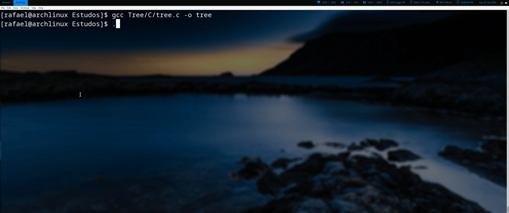

# Tree

Tree is a lightweight implementation of the [tree](https://en.wikipedia.org/wiki/Tree_(command)) command in C.

I built this project to try a non-recursive way of walking through a filesystem. Instead of using recursive function calls to descend into directories, Tree keeps its own traversal state in a custom linked stack. This avoids growing the call stack on deeply nested directory trees and makes the traversal logic more explicit.

## How it works

Tree starts from the current working directory and pushes it onto a linked stack. Then, while the stack is not empty, it pops one entry, prints it, checks whether it is a directory, and pushes its children onto the stack.

This turns the usual recursive traversal pattern into an iterative one:

```text
push starting directory

while stack is not empty:
    pop next entry
    print entry

    if entry is a directory:
        read its children
        push children onto the stack
```

The interesting part is not that the program prints directories, but that the traversal state is handled manually instead of being hidden inside recursive calls.

## Demo




## Build and run

Tree has no external library dependencies. It uses the standard C library together with POSIX filesystem APIs, and was made with Linux in mind.

To build and run it:
```bash
  make
  ./tree
```

To clean the compiled binary:

make clean
